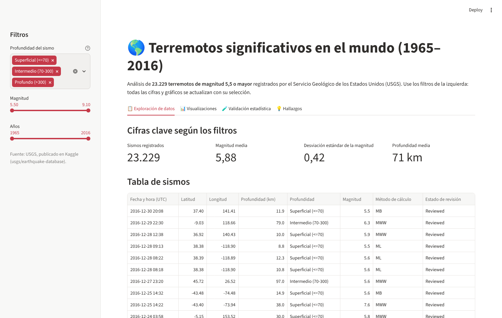
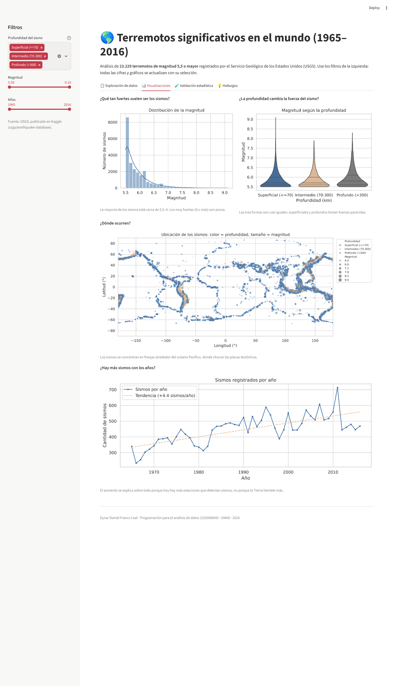

# 🌎 Terremotos significativos en el mundo (1965–2016) – Dashboard interactivo

[](https://sismos-eynarfranco.streamlit.app)

## Descripción del proyecto

Este dashboard presenta, para una audiencia no técnica, el análisis exploratorio de datos (EDA) que hice en la Tarea 3 del curso *Programación para el análisis de datos*. No es un análisis nuevo: usa los mismos datos, la misma limpieza y llega a las mismas conclusiones, pero de forma interactiva y en lenguaje sencillo.

El conjunto de datos es **Significant Earthquakes, 1965–2016**, del Servicio Geológico de los Estados Unidos (USGS), publicado en Kaggle. Reúne 23.412 eventos sísmicos de magnitud 5,5 o mayor; después de la limpieza (quitar explosiones nucleares y otros eventos que no son terremotos, 3 profundidades negativas y las columnas con más del 80 % de vacíos) quedan **23.229 terremotos**.

La pregunta que guía el análisis es si la **profundidad** y la **ubicación** de un sismo ayudan a anticipar **qué tan fuerte** será. Elegí este conjunto porque tiene variables medidas por instrumentos (profundidad, magnitud, coordenadas) y permite practicar el mismo razonamiento que uso en instrumentación industrial: distinguir entre dónde ocurre un evento y qué determina su magnitud.

## Dashboard publicado

👉 **[Abrir el dashboard](https://sismos-eynarfranco.streamlit.app)**

> Si la app estuvo varios días sin visitas, puede tardar entre 30 y 60 segundos en “despertar”. Es normal.




## Qué incluye

- **Filtros** (barra lateral): profundidad del sismo (selección múltiple), rango de magnitud y rango de años.
- **Exploración de datos:** cifras clave (número de sismos, magnitud media, desviación estándar y profundidad media) y tabla filtrable.
- **Visualizaciones:** distribución de la magnitud, magnitud según la profundidad (violín), mapa de ubicación y sismos registrados por año.
- **Validación estadística:** prueba t de Welch entre sismos superficiales y no superficiales, explicada en lenguaje claro.
- **Hallazgos:** qué analicé, qué encontré, qué significa y qué se recomendaría.

## Hallazgos principales

1. **La profundidad no indica la fuerza del sismo.** La magnitud media es prácticamente igual en sismos superficiales (5,88) y no superficiales (5,88); la prueba t no encuentra diferencia (p = 0,716).
2. **La ubicación indica dónde tiembla, no qué tan fuerte.** Los sismos se concentran en los bordes de las placas tectónicas, sobre todo alrededor del océano Pacífico.
3. **Se registran más sismos cada década** (de unos 290 por año en 1965–1969 a unos 517 en los años 2000), pero la magnitud media se mantiene cerca de 5,9: el aumento refleja una mejor red de detección.
4. **Los sismos muy fuertes son pocos pero reales:** 40 de magnitud 8 o más (por ejemplo, Sumatra 2004 y Japón 2011). Son valores atípicos válidos y no se eliminaron.

## Instalación y ejecución local

Requisitos: Python 3.10 o superior.

```bash
# 1. Clonar el repositorio
git clone https://github.com/eynardanf-code/dashboard-sismos.git
cd dashboard-sismos

# 2. (Opcional) crear un entorno virtual
python -m venv venv
venv\Scripts\activate        # Windows
# source venv/bin/activate   # macOS / Linux

# 3. Instalar las librerías
pip install -r requirements.txt

# 4. Ejecutar el dashboard
streamlit run app.py
```

El dashboard se abre en el navegador en `http://localhost:8501`.

## Estructura del repositorio

```
dashboard-sismos/
├── app.py             # código del dashboard
├── database.csv       # datos USGS 1965–2016 (2,4 MB)
├── requirements.txt   # librerías necesarias
├── README.md          # este documento
└── img/               # capturas del dashboard
```

## Fuente de los datos

U.S. Geological Survey. (2017). *Significant Earthquakes, 1965–2016* [Conjunto de datos]. Kaggle. https://www.kaggle.com/datasets/usgs/earthquake-database

## Autor

**Eynar Daniel Franco Leal**
Curso: Programación para el análisis de datos (203008069) – Grupo 33
Especialización en Ciencia de Datos y Analítica – Universidad Nacional Abierta y a Distancia (UNAD)
Diciembre de 2026
